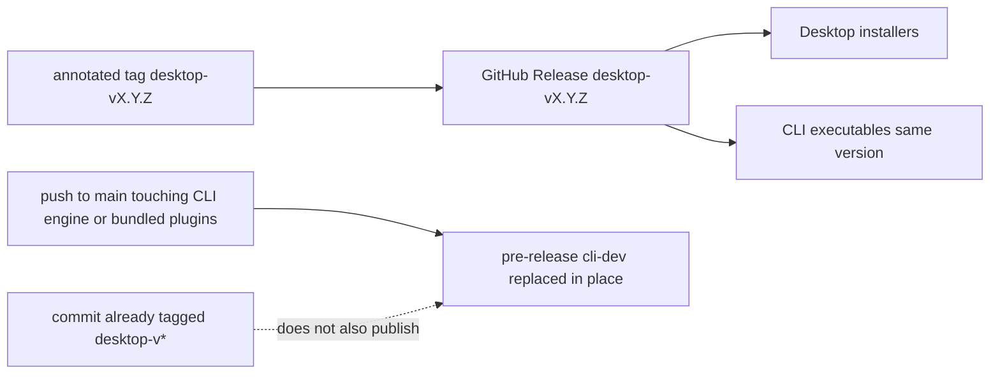

# Implementation Plan: Standalone cross-platform BeatBax CLI executable

**Spec**: [spec.md](spec.md) | **Date**: 2026-11-06 | **Branch**: `feat/106-cli-standalone-executable`

## Summary

Package `@beatbax/cli` (plus its engine and declared plugin dependencies) into per-OS executables that do not require a user-installed Node/npm/npx. Version the binary like Desktop (`apps/desktop/package.json`). Upload stable artifacts onto the existing `desktop-v*` GitHub Release; publish Development on a rolling `cli-dev` pre-release. Prefer Node’s single-executable application (SEA); if SEA cannot load the ESM graph or dynamic plugin imports, ship a zip that embeds its own Node runtime so the user still does not install Node. No language, AST, ISM, or scheduler changes. npm Changesets publishing stays as today.

## Technical context

- **Packages / surfaces**: `packages/cli`, `packages/engine` (Node entry / playback), bundled plugins under `packages/plugins/chip-sms`, `packages/plugins/export-famitracker`, `packages/plugins/export-vgm`, CI under `.github/workflows/`, release docs under `docs/release/`
- **Language**: TypeScript (strict), ESM
- **Testing**: Jest via `npm test`; plus smoke of the built executable in CI
- **Client profile**: CLI
- **Performance / constraints**: Artifact size and macOS notarization minutes matter; match Desktop OS/arch matrix only

## Constitution Check

GATE: must pass before implementation. Re-check after design changes.

- [x] No invented syntax or undocumented language behavior — packaging only; command surface equals `@beatbax/cli` at the commit
- [x] AST / ISM / scheduler / expansion impact identified (or N/A) — N/A
- [x] Plugins remain isolated; core does not gain plugin dependencies — packaging bundles plugins that `@beatbax/cli` already depends on; engine/core MUST NOT gain new plugin imports for this feature
- [x] Determinism and compatibility preserved (or migration documented) — npm CLI behavior unchanged; executable and npm versions may differ by design
- [x] Tests planned for new behavior — version output, bundled plugin list, executable smoke (`--version`, `verify` or `export`)

**Exceptions**: none

## Project structure

Expected implementation touchpoints (not created by this specification-only PR):

- Packaging scripts (likely under `packages/cli/scripts/` or `scripts/`) — SEA build or embedded-Node zip
- Version injection — release version from `apps/desktop/package.json`, npm package version from `packages/cli/package.json`
- `.github/workflows/` — new or extended workflow for `cli-dev`; stable upload job after Desktop installers exist on `desktop-v*`
- Checksum / GPG integration with existing Desktop release flattening/signing scripts where shared
- Docs: `docs/release/releasing.md`, `packages/cli/README.md`, short QA checklist under `docs/qa/`
- Optional `specs/features/106-cli-standalone-executable/research.md` if SEA is rejected

## Implementation

### AST changes

None.

### Parser / grammar changes

None.

### CLI changes

- Inject dual version reporting for packaged builds (`--version`: release version, then embedded `@beatbax/cli` version).
- Ensure bundled plugins are resolvable without a host `node_modules` (preload or package-relative resolution for the declared dependency set).
- Keep existing cwd `node_modules` discovery for extra plugins.
- `play` audio: attempt to include optional `speaker` only if the chosen packager supports it without requiring user Node; otherwise document fallbacks.

### Desktop / web UI changes

None required for product UI. Stable publish may extend the Desktop build/publish workflow only to attach CLI assets and merge `SHA256SUMS` after both installer and CLI sets exist.

### Export changes

None (exporters already used by CLI; packaging only).

### Documentation updates

- `docs/release/releasing.md` — third distribution channel: CLI executables; `cli-dev` triggers; artifact names; version vs npm
- `packages/cli/README.md` — download links / no-Node install path
- `docs/qa/` — short CLI executable QA checklist (stable + Development)
- `desktop-v*` release body template / notes — name CLI assets and “no Node required”

## Packaging approach

1. **Default**: Node single-executable application (SEA), because the CLI is already Node ESM.
2. **First implementation task**: spike SEA with the monorepo ESM graph, dynamic `import()` of bundled plugins, and optional native `speaker`.
3. **Fallback**: zip (or directory) that embeds a Node runtime and the CLI tree. User MUST still not install Node. Record the choice in `research.md` only if SEA is rejected.
4. **macOS**: produce a notarizable zip containing the executable (align with Desktop `.zip` + Developer ID + notarize when secrets exist).
5. **Windows / Linux**: single binary (or equivalent runnable entry) named per FR-006 / FR-007.

## Release and CI approach

- **Stable**: On `desktop-v*` tag pipeline, after installers are uploaded (or in a coordinated publish job), build CLI for the three platforms, upload assets to the same release, regenerate `SHA256SUMS` to include both sets, apply optional GPG, and mention CLI in the release body.
- **Development**: Path-filtered `main` workflow publishes `cli-dev` only (not GitHub Latest). Skip when the commit is already tagged `desktop-v*`. Cancel in-progress runs on rapid pushes if Desktop does.
- **Secrets**: Reuse Apple and GPG secrets already used for Desktop when present.

## Testing strategy

### Unit tests

- Version helper: release version vs package version formatting.
- Bundled plugin registration without host `node_modules` (or packaging manifest assertion).

### Integration tests

- CI smoke: run the built executable with `--version` and `verify` (or `export`) on a fixture song for each matrix OS.

### Manual / QA

- Fill `docs/qa/` checklist once per first stable ship: download without Node, SmartScreen/Gatekeeper notes, checksum verify, `play` fallback behavior.

## Migration and compatibility

- Existing npm users: no break; keep documenting `npm install -g` / `npx`.
- Executable users: new download path; versions align with Desktop, not with npm semver of `@beatbax/cli`.

## Open implementation questions

- SEA vs embedded-Node zip (see spec OQ-1).
- Fine-grained vs broad `package-lock.json` trigger for `cli-dev` (see spec OQ-2).
- Whether stable CLI build shares runners with Desktop: Package or runs as a follow-on job on the same tag workflow.
